<div align="center">


# SIAB · Simulador Interativo de Ácidos e Bases

### A química das cores

**Observe. Meça. Interprete. Investigue.**

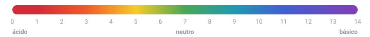


### [Abrir o SIAB no navegador ](https://qui-x.github.io/acidobase/)
### [Pacotes de Instalação ](https://drive.google.com/drive/u/1/folders/1RN7ACQXWp_Ho-LZKXxt03sdt0mKZDaWK)
<sub>Sem cadastro, sem instalar nada, no computador ou no celular.</sub>

<br>

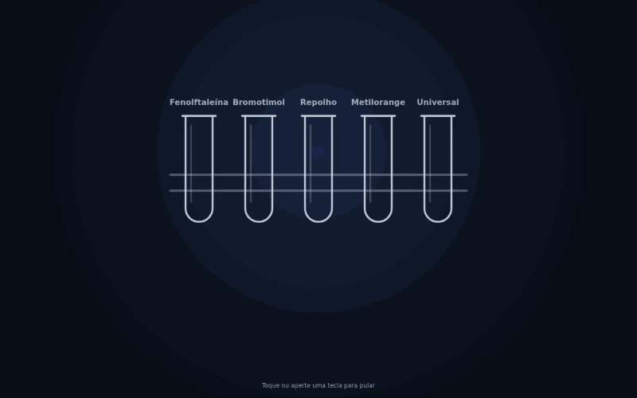

</div>

---

##  O que é o SIAB?

O SIAB é um **laboratório de ácidos e bases que cabe no navegador**. Você monta a bancada, escolhe uma solução e um indicador, pinga gota a gota e acompanha o que acontece:

- a **cor** do indicador mudando;
- o **pH** medido com fita ou pHmetro;
- as **partículas** reagindo lá dentro;
- o **gráfico** se desenhando a cada leitura.

### Por que ele existe

Ácidos e bases são cheios de coisas que **não dá para ver**: íons, prótons pulando de uma molécula para outra, equilíbrios que nunca param. E nem toda escola tem reagentes, vidraria e tempo de laboratório para todo mundo experimentar.

O SIAB traduz esse conteúdo para o mundo digital **sem abrir mão da ciência**. Cada cor que aparece na tela vem de um cálculo de equilíbrio químico, não de uma animação enfeitada. Ele não substitui o laboratório de verdade: é o lugar para errar, repetir e perguntar "e se…?" quantas vezes quiser.

**Para quem:** estudantes do ensino médio e técnico, e professores que querem levar a investigação para a sala de aula, o laboratório de informática ou o celular dos alunos.

---

##  Comece em 30 segundos

1. Abra o **[SIAB](https://qui-x.github.io/acidobase/)** e entre no **Laboratório**.
2. Em **Montagem**, escolha uma solução (que tal *Suco de limão*?) e um indicador (*Extrato de repolho roxo*).
3. Segure **+ Segure para gotejar** e veja a cor mudar.
4. Em **Ver → Medir**, mergulhe uma fita de pH ou ligue o pHmetro.
5. Em **Ver → Analisar**, acompanhe o gráfico. Em **Dados**, ficam a tabela e o relatório.

> **Dica:** quer ir direto ao ponto? Em **Montagens prontas** há 11 bancadas montadas, como *Ácido forte × base forte* e o *Arco-íris do pH*.

---

##  Um passeio pelo laboratório

### Pingue e veja a cor virar

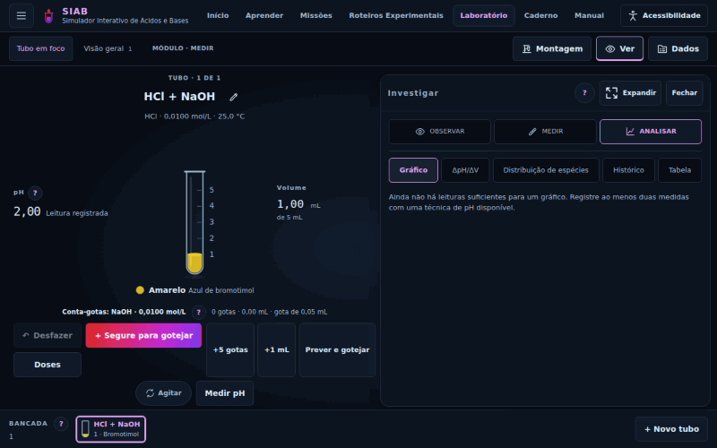

Ácido clorídrico (HCl, 0,0100 mol/L) recebe hidróxido de sódio (NaOH) com **azul de bromotimol**: amarelo, verde no ponto de equivalência, azul depois dele. O pHmetro registra cada leitura e o gráfico desenha a famosa **curva em S**.

Repare na estratégia: **+5 gotas** enquanto o pH quase não muda e **gota a gota perto da equivalência**, como numa titulação de verdade. Entre a 19ª e a 21ª gota o pH salta de cerca de 3,6 para 10,4!

### Cada gota cai em um lugar

<div align="center">
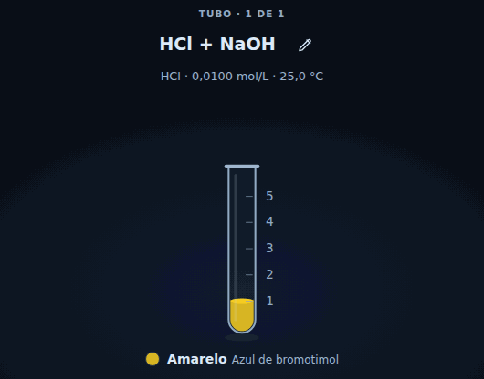
</div>

A gota não muda o tubo inteiro de uma vez: ela colore **só onde cai**. Toque em **Agitar** e a mistura fica homogênea, com a cor que corresponde ao pH da solução toda. É o mesmo que acontece no béquer quando você esquece de mexer!

### Veja o invisível

<div align="center">
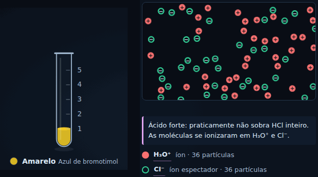
</div>

Em **Ver → Observar → Partículas**, cada OH⁻ que chega encontra um H₃O⁺ e os dois viram água: **H₃O⁺ + OH⁻ → 2 H₂O**. O Cl⁻ e o Na⁺ só assistem: são **íons espectadores**. Depois da equivalência, os OH⁻ começam a sobrar, e é por isso que o pH dispara.

### O arco-íris do pH

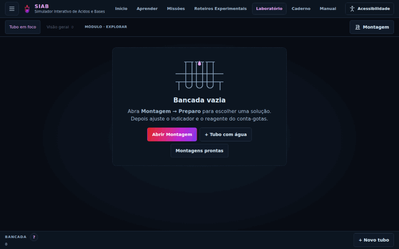

Sete soluções, um indicador universal, todas as cores da escala: ácido clorídrico, ácido clorídrico diluído, cloreto de amônio, água pura, acetato de sódio, amônia e hidróxido de sódio. De **vermelho** a **roxo**, passando pelo verde da água pura. Sais também mudam o pH!

### No celular também

<table>
<tr>
<td width="300">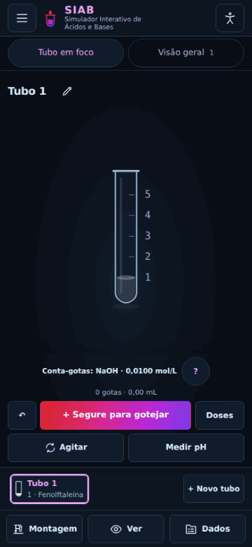</td>
<td>

O SIAB foi pensado para **caber na palma da mão**:

- segure o botão e as gotas caem sem parar; solte e elas param;
- cada sequência termina com um aviso do **volume que realmente entrou**;
- a fita de pH mostra a leitura logo abaixo do tubo;
- Montagem, Ver e Dados abrem como painéis que sobem da parte de baixo da tela.

Aqui, ácido clorídrico com **fenolftaleína**: incolor no ácido, rosa assim que passa da equivalência.

</td>
</tr>
</table>

---

##  Tem muito mais

<table>
<tr>
<td width="50%">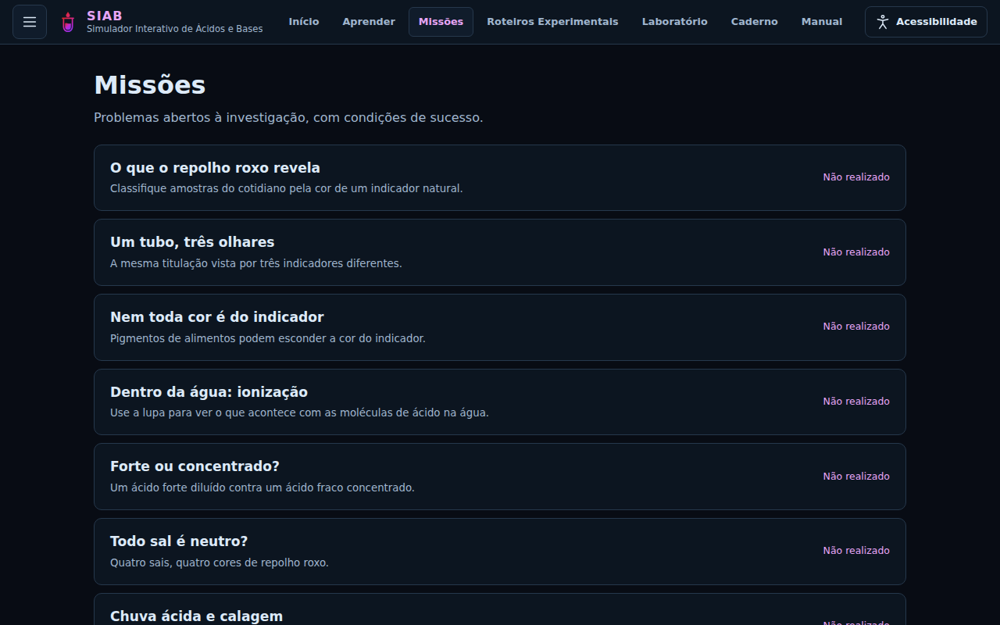<br><b>Missões:</b> problemas abertos com condições de sucesso, como <i>"Todo sal é neutro?"</i></td>
<td width="50%">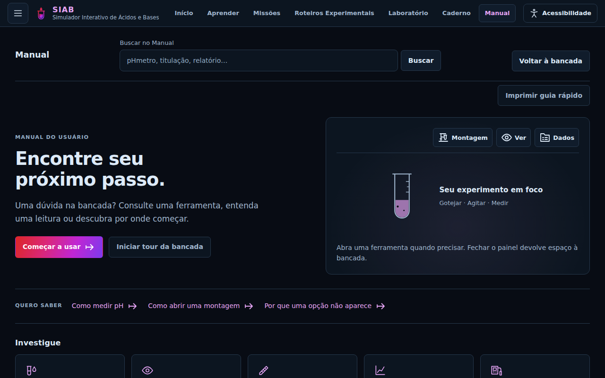<br><b>Manual:</b> busca, passo a passo e ajuda sobre cada controle da bancada.</td>
</tr>
<tr>
<td>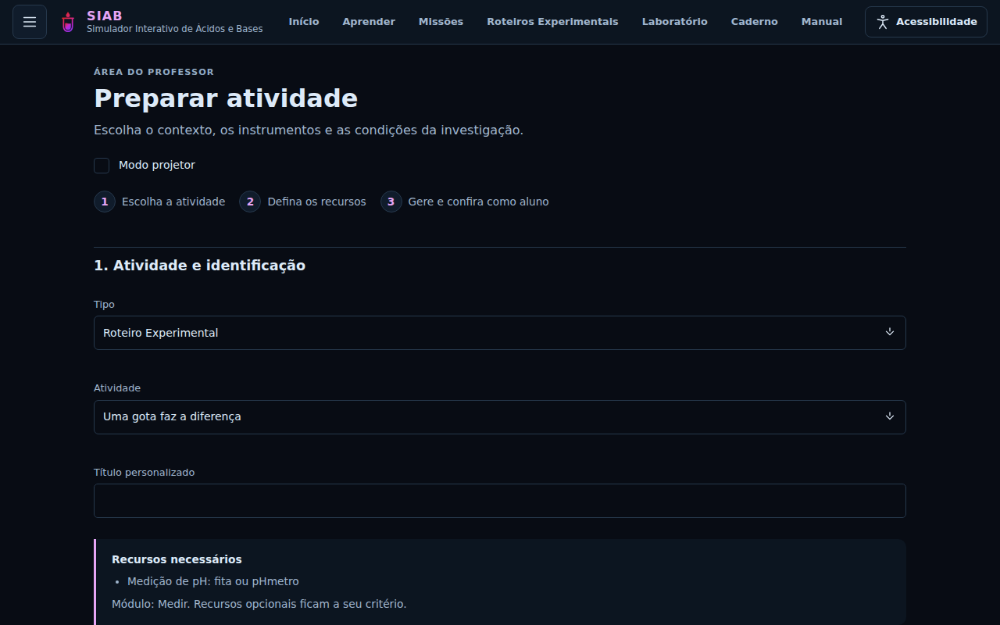<br><b>Área do Professor:</b> monte a atividade, escolha os instrumentos e gere um link para a turma.</td>
<td>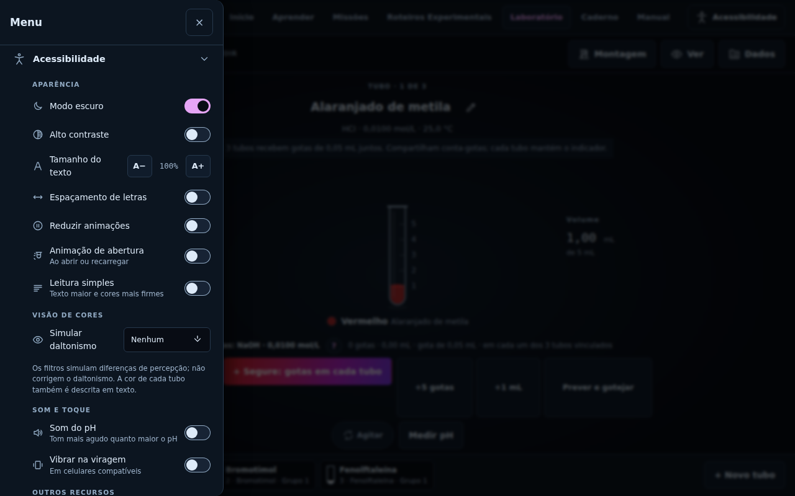<br><b>Acessibilidade:</b> contraste, tamanho do texto, daltonismo, som do pH e mais.</td>
</tr>
</table>

| | O que tem |
|---|---|
|  **140 substâncias** | 5 ácidos fortes, 13 ácidos fracos, 5 bases fortes, 12 bases fracas, 35 sais, 12 ácidos polipróticos e aminoácidos (ácido fosfórico, ácido cítrico, glicina…), 2 suspensões, água e **55 amostras do cotidiano**: suco de limão, vinagre, refrigerante, leite, café, água sanitária, saliva, água do mar… |
|  **11 indicadores** | Fenolftaleína, azul de bromotimol, alaranjado de metila, vermelho de metila, verde de bromocresol, vermelho de fenol, timolftaleína, tornassol, indicador universal e dois naturais: **repolho roxo** e **cúrcuma** |
|  **3 vidrarias** | Tubo de ensaio, béquer e erlenmeyer |
|  **Instrumentos** | Fita de pH, pHmetro com calibração de dois pontos, termômetro e condutivímetro |
|  **Gráficos e dados** | pH × volume, ΔpH/ΔV, distribuição de espécies, tabela de medições e histórico |
|  **Três módulos** | **Explorar** (observar a cor mudar), **Medir** (controlar quantidades e registrar leituras) e **Calcular** (concentrações, [H₃O⁺], [OH⁻], Ka, Kb e α) |
|  **Para aprender** | 14 temas, 19 missões, 35 roteiros experimentais e 11 montagens prontas |
|  **Caderno e relatório** | O Caderno guarda notas e práticas. O relatório sai completo, para preencher à mão ou como atividade de análise, e pode ser impresso ou salvo em PDF |

---

##  A ciência por trás das cores

O SIAB não "chuta" o pH. Para cada tubo ele resolve o equilíbrio químico de verdade:

- **Balanço de cargas e de massa.** O pH é a raiz numérica do balanço de cargas (soma das cargas positivas = soma das negativas), junto com os balanços de massa de cada par ácido-base. Por isso misturas, diluições, sais e tampões funcionam sem regras especiais. O pH de uma mistura nunca é a média dos pHs!
- **Temperatura.** O pKw da água muda com a temperatura, e a neutralidade é **pH = pKw/2**. A 25 °C isso dá 7, mas a água pura continua neutra mesmo quando o pH dela não é 7.
- **Indicadores.** A cor sai do pKIn e da faixa de viragem de cada indicador.
- **Condutividade.** Usa a lei de Kohlrausch, **κ = Σ λ°·c**, com as condutividades iônicas limite do *CRC Handbook*.
- **Instrumentos honestos.** A fita arredonda para uma unidade de pH. O pHmetro tem resolução de 0,01 e leva 0,5 s para estabilizar. Os gráficos usam só leituras que você registrou; o que é resultado do modelo vem identificado como tal.

E os limites são assumidos às claras. É um modelo didático: solução ideal, atividades aproximadas por concentrações, equilíbrio instantâneo. As amostras do cotidiano têm composição representativa, não a de um produto real. O SIAB **não** é instrumento de laboratório nem de diagnóstico.

<sub>Referências: OpenStax Chemistry 2e; D. C. Harris, <i>Análise Química Quantitativa</i>; <i>CRC Handbook of Chemistry and Physics</i>; IAPWS (ionização da água); Bandura e Lvov (2006); Nelson e Cox, <i>Lehninger</i>; Baes e Mesmer, <i>The Hydrolysis of Cations</i>.</sub>

---

##  Para professores

- **Prepare em três passos:** escolha uma missão, um roteiro ou uma montagem; defina instrumentos, temperatura e navegação; gere o link e **abra como aluno** para conferir.
- **Modo projetor** para mostrar a bancada para a turma toda.
- **Relatórios** separam condições iniciais, medições, representações, interpretação e condições finais. A versão **para preencher à mão** mantém os dados e deixa em branco só os campos de autoria do aluno.
- As respostas de referência ficam na área do professor, e cada link carrega a própria configuração.

##  Acessível de verdade

Modo escuro e claro, **alto contraste**, tamanho do texto, espaçamento de letras, **reduzir animações**, leitura simples e **simulação de daltonismo**. A cor de cada tubo também é descrita em texto. O **som do pH** fica mais agudo quanto maior o pH, e o celular pode **vibrar na viragem**. O VLibras é opcional e precisa de internet.

##  Funciona sem internet

- **Como aplicativo:** abra o SIAB conectado uma vez e use **Instalar** no navegador. Depois ele abre mesmo offline.
- **Arquivo único:** baixe o [`SIAB-1.0.0-standalone.html`](../SIAB-1.0.0-standalone.html) (botão de download na página do arquivo) e abra direto no navegador, sem servidor e sem instalar nada.
- **Seus dados ficam com você:** não há conta. Caderno, sessões e relatórios ficam guardados no próprio navegador. Só os extras opcionais (clima da sua cidade e VLibras) usam a internet.

---

##  Rodar no seu computador

```bash
git clone https://github.com/qui-x/acidobase.git
cd acidobase
python3 -m http.server 8080
```

Abra `http://localhost:8080`. Não precisa de Node, npm nem compilação: é HTML, CSS e JavaScript puros.

<details>
<summary><b>Como o repositório está organizado</b></summary>

<br>

| Ramo | O que tem |
|---|---|
| `acidosebases1.0.0` (principal) | Só o que roda o programa: `index.html`, `css/`, `js/`, `assets/`, `vendor/`, `sw.js`, o manifesto, o standalone e a licença |
| [`claude/testes`](https://github.com/qui-x/acidobase/tree/claude/testes) | Tudo o mais: [manual](https://github.com/qui-x/acidobase/blob/claude/testes/docs/MANUAL.md), [modelo científico](https://github.com/qui-x/acidobase/blob/claude/testes/docs/MODELO-CIENTIFICO.md), [limitações](https://github.com/qui-x/acidobase/blob/claude/testes/docs/LIMITACOES.md), [validação](https://github.com/qui-x/acidobase/blob/claude/testes/VALIDACAO.md), [histórico de versões](https://github.com/qui-x/acidobase/blob/claude/testes/CHANGELOG.md), scripts de geração e manifestos SHA |

</details>

---

##  Licença

SIAB é software livre sob a licença [GPL-3.0](../LICENSE): use, estude, modifique e compartilhe. O [dialog-polyfill](../vendor/dialog-polyfill/LICENSE) incluído segue a licença BSD-3-Clause.

---

##  Créditos

Desenvolvido por **Thiago Weslei** no **IFBA**, o Instituto Federal de Educação, Ciência e Tecnologia da Bahia - Campus Vitória da Conquista.

<div align="center">

<br>

**Feito para quem ensina e aprende química.**

<sub>Gostou? Deixe uma estrela no repositório e mostre o SIAB para sua turma.</sub>

</div>
