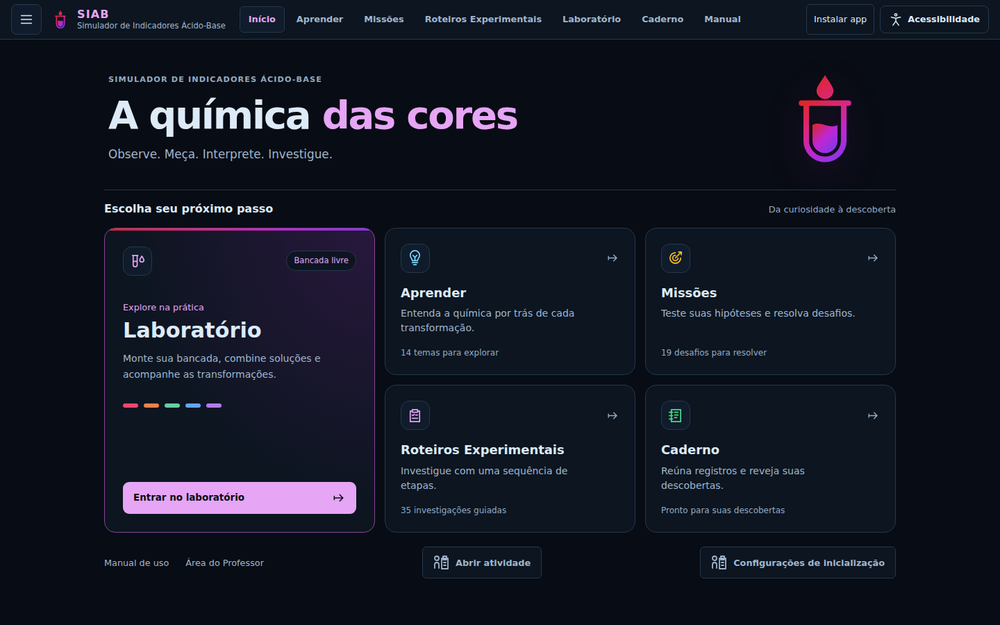
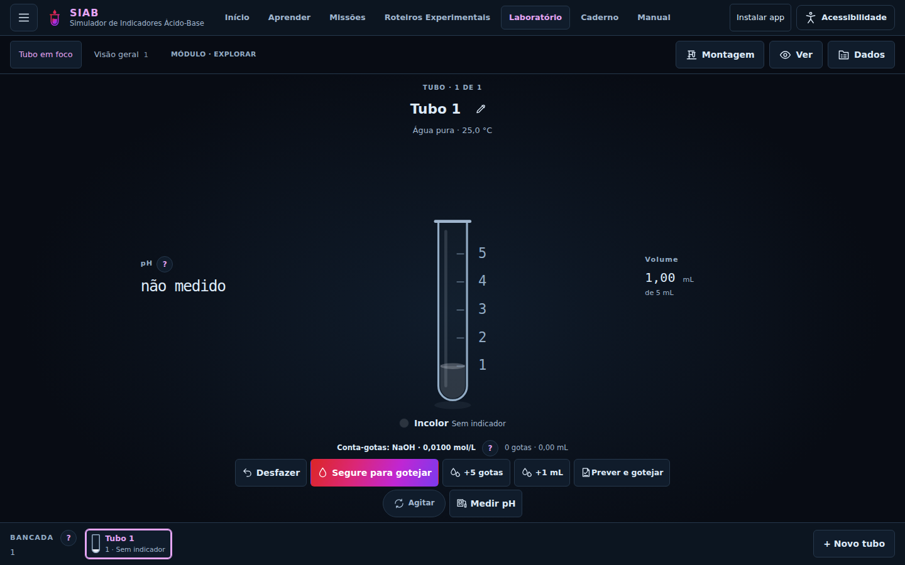
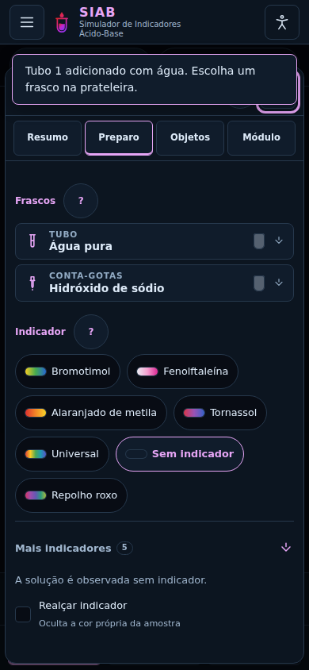
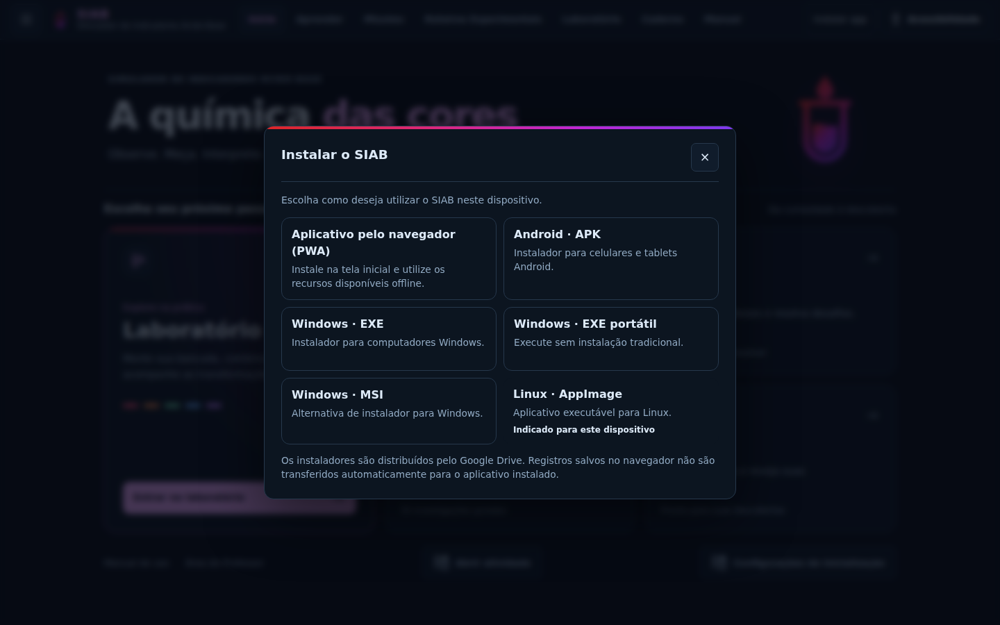
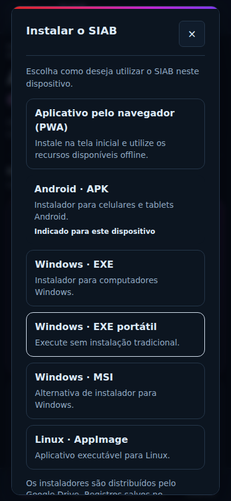
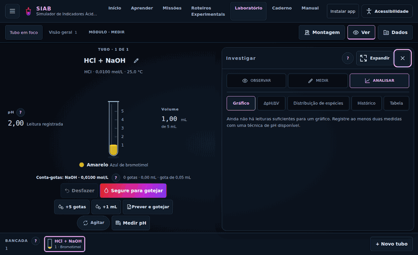
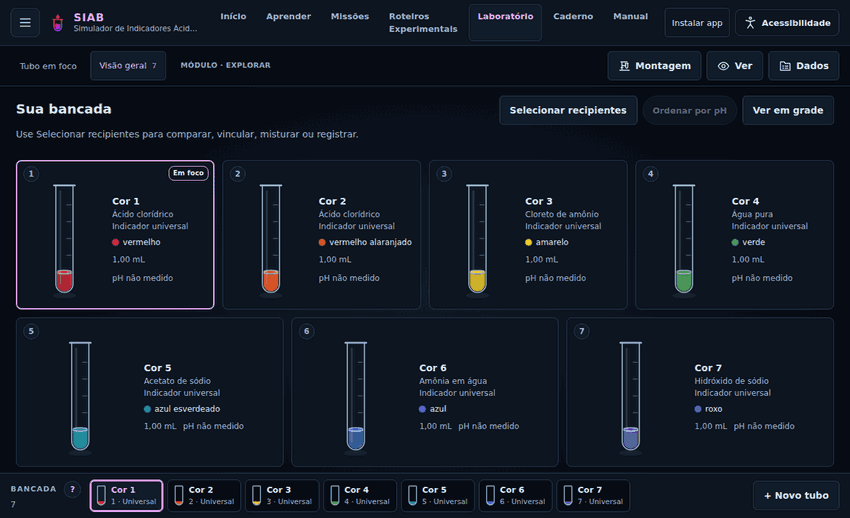

# SIAB 1.0.0

Simulador de Indicadores Ácido-Base. Aplicação educacional estática com 140 substâncias, módulos Explorar, Medir e Calcular, instrumentos, atividades, Manual, relatórios e Caderno local.

Versão estável oficial, com a correção da bancada mobile encontrada nos testes finais: vidraria estável, identificação compacta e avisos contextuais de adição e de medição concluída. O motor científico e os módulos existentes foram preservados.

## Capturas da interface atual

As imagens abaixo são capturas reais da aplicação **SIAB 1.0.0**, realizadas na revisão de 12 de novembro de 2026, em visualizações desktop e mobile.

| Bancada de investigação no computador | Bancada de investigação no celular |
|---|---|
|  |  |

| Escolha de instalação no computador | Escolha de instalação no Android |
|---|---|
|  |  |

Veja também as capturas de **Missões, Roteiros Experimentais, Manual, Área do Professor e Acessibilidade** no [README ilustrado](.github/README.md).

### Demonstrações atualizadas

Estas animações foram regravadas no SIAB com interações e medidas reais, para acompanhar os novos controles e painéis.

| Titulação e gráfico de pH | Arco-íris do pH |
|---|---|
|  |  |

[Confira as demais animações (abertura, agitação, partículas e mobile) no README ilustrado](.github/README.md).

## Abrir e instalar

- **Distribuição modular completa:** extraia `SIAB-1.0.0.zip` e sirva a pasta `SIAB/` em um servidor web. Para uso local, nela execute `python3 -m http.server 8080` e abra `http://localhost:8080`.
- **PWA:** publique a pasta modular em HTTPS ou use localhost. Abra conectado e aguarde o cache antes de desconectar. Use Instalar no navegador ou no menu, quando disponível.

Requisitos: navegador moderno com JavaScript. Node, npm e ferramentas de teste não são exigidos para usar o programa. Python é somente uma opção para servir a versão modular localmente.

A opção **Instalar app** apresenta PWA e downloads para Android (APK), Windows (EXE, portátil e MSI) e Linux (AppImage). Os downloads são publicados em uma pasta do Google Drive; a seleção destaca o formato correspondente ao dispositivo, sem apresentar indicadores internos de armazenamento no menu. O navegador continua oferecendo instalação PWA quando compatível.

## Offline e atualização

Laboratório, Manual, Montagens, Relatório e Caderno são locais. Open-Meteo e VLibras são opcionais e precisam de internet. As fontes são do sistema.

Ao substituir os arquivos da versão anterior no mesmo endereço, o service worker prepara o cache `siab-1.0.0+20261112-instalar-visual-limpo` e oferece **Recarregar**. O sufixo identifica esta revisão da 1.0.0, que centraliza os controles de ação em diferentes tamanhos de tela e permite retornar à bancada após gotejar, retomando posteriormente a previsão sem repetir doses. Os arquivos offline acompanham as mudanças. A limpeza afeta apenas caches antigos desta publicação. Caderno, sessões, práticas, relatórios e preferências permanecem armazenados no navegador.

Mantenha a mesma origem, caminho e perfil para conservar os dados. Trocar domínio, aparelho ou perfil não transfere registros automaticamente. Exporte o Caderno e salve os relatórios antes de limpar dados do navegador.

## Estrutura

| Caminho | Finalidade |
|---|---|
| `index.html`, `a11y.js`, `css/`, `js/` | Aplicação e acessibilidade |
| `sw.js`, `manifest.webmanifest` | Cache offline e instalação |
| `assets/`, favicons | Marca e ícones utilizados |
| `vendor/dialog-polyfill/` | Compatibilidade local de diálogos e licença |
| `docs/` | Manual, modelo científico, migração e limitações |
| Documentos na raiz | Uso, validação, compatibilidade, dependências e mudanças |
| `FILES.txt`, `SHA256SUMS.txt`, `SHA512SUMS.txt` | Manifesto e integridade dos arquivos |

Esta entrega contém a distribuição modular. O arquivo único `SIAB-1.0.0-standalone.html` do código-fonte foi gerado do mesmo código corrigido; um arquivo único baixado antes não se atualiza sozinho. As capturas e o relatório desta correção acompanham a entrega separadamente.

## Documentação e limites

[Guia de uso](LEIA-ME.md) · [Manual](docs/MANUAL.md) · [Validação](VALIDACAO.md) · [Compatibilidade](COMPATIBILIDADE.md) · [Dependências](DEPENDENCIAS.md) · [Mudanças](CHANGELOG.md) · [Limitações](docs/LIMITACOES.md) · [Licença](LICENSE).

A correção da 1.0.0 foi validada em Chromium com viewports emulados. Firefox/Gecko e Safari/WebKit não estavam disponíveis para esta rodada. Aparelhos físicos, leitores de tela reais, instalação pelo sistema e impressão física não foram testados. O registro da versão anterior em VALIDACAO.md é histórico, não uma reexecução com a correção. O modelo é didático, com hipóteses descritas em [MODELO-CIENTIFICO.md](docs/MODELO-CIENTIFICO.md).
